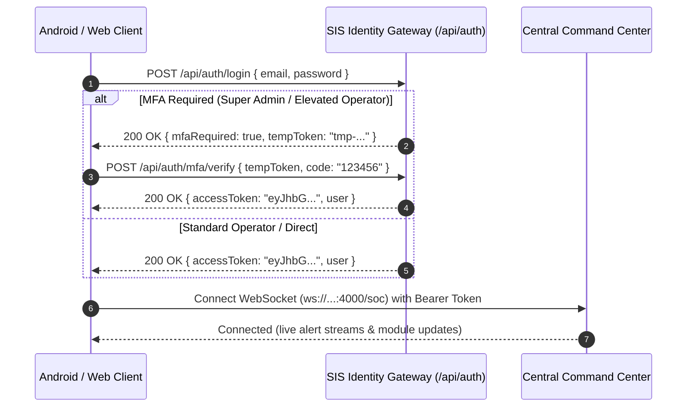

# SIS CYBER FORTRESS — CLIENT API INTEGRATION & RUNTIME GUIDE
**Document Version:** 2.0.0  
**Target Consumers:** SIS Cyber Fortress Android Mobile App (`com.sis.cyberfortress`) & Next.js Super Admin Dashboard  

---

## 1. UNIFIED NETWORK TOPOLOGY & ENDPOINTS

Both the Kotlin Android Application and the Next.js Enterprise Super Admin interact with the identical shared NestJS backend instance:

| Environment | Base URL (REST API) | Base URL (WebSocket) |
|---|---|---|
| **Host Machine / Web Admin** | `http://localhost:4000/api` | `ws://localhost:4000/soc` |
| **Android Standard Emulator** | `http://10.0.2.2:4000/api` | `ws://10.0.2.2:4000/soc` |
| **MuMu Player / Physical Device** | `http://192.168.50.91:4000/api` | `ws://192.168.50.91:4000/soc` |

---

## 2. AUTHENTICATION & AUTHORIZATION SPECIFICATION

All endpoints (except `/api/auth/login` and `/api/health/*`) require a valid Bearer JWT header:

```http
Authorization: Bearer <ACCESS_TOKEN>
```

### Complete Authentication Handshake


---

## 3. HANDLING RUNTIME HTTP 503 RESPONSES (DISABLED MODULES)

When a module has been disabled or placed into maintenance by an administrator, any direct API request to that module's endpoints is intercepted by `ModuleActiveGuard`:

```http
HTTP/1.1 503 Service Unavailable
Content-Type: application/json

{
  "statusCode": 503,
  "error": "Service Unavailable",
  "message": "Module 'SIS Phishing Shield' is currently DISABLED by administrator security policy. Underlying data remains preserved.",
  "moduleId": "sis-phishing",
  "moduleStatus": "DISABLED",
  "timestamp": "2026-11-11T12:00:00.000Z"
}
```

### Recommended Client-Side Handling:
1. **In Next.js Admin UI:**
   Display a yellow banner / toast: `"Module is currently paused by security policy. Enable it in the Central Module Registry to resume live actions."`
   Do not show a raw application crash or generic 500 error.
2. **In Android Mobile App:**
   In Retrofit interceptors or repository error mappers:
   ```kotlin
   if (response.code() == 503) {
       val err = parseModuleStatusError(response.errorBody()?.string())
       showModuleOfflineDialog(err.moduleName, err.moduleStatus)
   }
   ```

---

## 4. CORE INTEGRATION WORKFLOWS

### Workflow A: Real-Time Phishing Inspection
```bash
curl -X POST http://localhost:4000/api/phishing/scan \
  -H "Content-Type: application/json" \
  -H "Authorization: Bearer <TOKEN>" \
  -d '{
    "target": "http://login-verify-account-update.xyz/auth/login.php",
    "type": "URL"
  }'
```
**Response:**
```json
{
  "scanId": "scn-1731309876",
  "target": "http://login-verify-account-update.xyz/auth/login.php",
  "type": "URL",
  "threatScore": 100,
  "verdict": "MALICIOUS",
  "indicators": [
    "Suspicious credential keywords: [login, verify]",
    "High-risk top-level domain (.xyz)"
  ],
  "scannedAt": "2026-11-11T12:00:00.000Z",
  "quarantined": true
}
```

---

### Workflow B: Ransomware Canary Tripwire Simulation
```bash
curl -X POST http://localhost:4000/api/ransomware/tripwires/test \
  -H "Content-Type: application/json" \
  -H "Authorization: Bearer <TOKEN>" \
  -d '{
    "canaryId": "CANARY-FINANCE-01",
    "simulatedEntropy": 8.24
  }'
```
**Response:**
```json
{
  "success": true,
  "alertDispatched": true,
  "canaryStatus": "MUTATED",
  "simulatedEntropy": 8.24,
  "message": "Ransomware tripwire triggered. Critical incident dispatched to Cyber SOC."
}
```

---

### Workflow C: Module Lifecycle Toggling (Enable / Disable)
```bash
# Disable a module (Evaluates downstream impact before executing)
curl -X POST http://localhost:4000/api/modules/sis-phishing/disable \
  -H "Content-Type: application/json" \
  -H "Authorization: Bearer <TOKEN>" \
  -d '{ "force": true }'

# Re-enable the module (Validates upstream dependencies)
curl -X POST http://localhost:4000/api/modules/sis-phishing/enable \
  -H "Authorization: Bearer <TOKEN>"
```

---

### Workflow D: Host Network Isolation (Automated Containment)
```bash
curl -X POST http://localhost:4000/api/ransomware/isolate-host \
  -H "Content-Type: application/json" \
  -H "Authorization: Bearer <TOKEN>" \
  -d '{
    "hostIdentifier": "10.0.12.88",
    "reason": "Tripwire canary mutated with Shannon entropy 8.24"
  }'
```
**Response:**
```json
{
  "success": true,
  "isolatedHost": "10.0.12.88",
  "networkState": "QUARANTINED_ISOLATED",
  "timestamp": "2026-11-11T12:00:00.000Z",
  "message": "Host 10.0.12.88 isolated from enterprise network segment. Lateral movement severed."
}
```

---

## 5. ZERO-KNOWLEDGE CRYPTOGRAPHIC CONTRACT

1. Secrets uploaded to `/api/vault/records` MUST be encrypted on the client device (AES-256-GCM) with an encryption key derived client-side via PBKDF2 or Argon2id.
2. The backend server never receives:
   - Plaintext passwords or secrets
   - Master encryption passphrases
   - Decryption keys or recovery master keys
3. All audit records for secret access are cryptographically signed and immutable in the central audit ledger.
