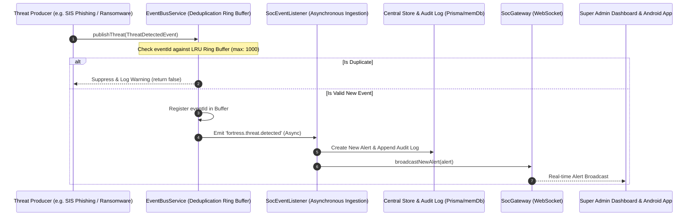

# SIS CYBER FORTRESS — CENTRAL EVENT CATALOG & BUS SPECIFICATION
**Document Version:** 2.0.0  
**Transport:** `@nestjs/event-emitter` (In-Process Decoupled Reactive Bus)  
**Deduplication Protocol:** LRU Ring Buffer with TTL Event Cache  

---

## 1. EVENT BUS ARCHITECTURE & DESIGN

The Decoupled Internal Event Bus decouples threat producers (e.g. Phishing Shield, Ransomware Guardian, Endpoint Guardian) from SOC telemetry ingestion, alerting, and automated containment actions.



---

## 2. EVENT PATTERN NAMESPACES

All internal security events follow hierarchical dot-delimited patterns defined in `SecurityEventPattern`:

```typescript
export enum SecurityEventPattern {
  THREAT_DETECTED = 'fortress.threat.detected',
  THREAT_CONTAINED = 'fortress.threat.contained',
  MODULE_STATE_CHANGED = 'fortress.module.state_changed',
  MODULE_CONFIG_UPDATED = 'fortress.module.config_updated',
  INCIDENT_CREATED = 'fortress.incident.created',
  INCIDENT_UPDATED = 'fortress.incident.updated',
  DEVICE_COMPLIANCE_CHANGED = 'fortress.device.compliance_changed',
  VAULT_KEY_ACCESSED = 'fortress.vault.key_accessed',
}
```

---

## 3. EVENT SCHEMAS & PRODUCER/CONSUMER MATRIX

### 1. `ThreatDetectedEvent` (`fortress.threat.detected`)
- **Producers:** `sis-phishing`, `sis-ransomware`, `sis-endpoint`, `sis-network`, `sis-webshield`, `sis-threat-intel`.
- **Consumers:** `SocEventListener`, `SocGateway`, Central Audit Logger.
- **Payload Schema:**
  ```typescript
  interface ThreatDetectedEvent {
    eventId: string;           // UUID or 'evt-{timestamp}-{random}'
    timestamp: string;         // ISO 8601 UTC
    sourceModuleId: string;    // e.g. 'sis-ransomware', 'sis-phishing'
    sourceModuleName: string;  // e.g. 'SIS Ransomware Guardian'
    threatType: string;        // 'PHISHING', 'RANSOMWARE_CANARY_TRIPWIRE', etc.
    severity: 'CRITICAL' | 'HIGH' | 'MEDIUM' | 'LOW';
    title: string;             // Human-readable SOC headline
    description: string;       // Detailed technical analysis
    targetEntity?: string;     // URL, IP, host path, device identifier
    iocIndicators?: string[];  // Extracted IoCs
    rawDetails?: Record<string, any>;
  }
  ```

---

### 2. `ModuleLifecycleEvent` (`fortress.module.state_changed`)
- **Producers:** `ModulesService` (Central Module Registry).
- **Consumers:** `SocEventListener`, `SocGateway` (WebSocket broadcast to Admin UI & Android).
- **Payload Schema:**
  ```typescript
  interface ModuleLifecycleEvent {
    eventId: string;
    timestamp: string;
    sourceModuleId: 'sis-module-center';
    moduleId: string;          // Target module ID
    moduleDisplayName: string;
    action: 'ENABLED' | 'DISABLED' | 'RESTARTED' | 'MAINTENANCE' | 'REGISTERED';
    currentStatus: 'ACTIVE' | 'DISABLED' | 'MAINTENANCE' | 'INSTALLED';
    actor: string;             // Super Admin name or service ID
    affectedDependents?: string[];
  }
  ```

---

### 3. `IncidentCreatedEvent` (`fortress.incident.created`)
- **Producers:** `SocService`, Automated SOAR Playbook runners.
- **Consumers:** Notification engine, Android push notification service, Audit store.
- **Payload Schema:**
  ```typescript
  interface IncidentCreatedEvent {
    eventId: string;
    timestamp: string;
    incidentId: string;
    incidentCode: string;      // e.g. 'INC-2026-0819'
    title: string;
    priority: 'P1_CRITICAL' | 'P2_HIGH' | 'P3_MEDIUM' | 'P4_LOW';
    assignedTeam: string;
  }
  ```

---

### 4. `DeviceComplianceEvent` (`fortress.device.compliance_changed`)
- **Producers:** `sis-endpoint` (MDM, Knox Attestation, Android Knox Play Integrity).
- **Consumers:** `SocEventListener`, Zero Trust Policy Enforcement Point.
- **Payload Schema:**
  ```typescript
  interface DeviceComplianceEvent {
    eventId: string;
    timestamp: string;
    deviceId: string;
    deviceName: string;
    isCompliant: boolean;
    violationDetails?: string[];
  }
  ```

---

### 5. `VaultAuditEvent` (`fortress.vault.key_accessed`)
- **Producers:** `sis-vault` (Zero-Knowledge Engine).
- **Consumers:** Central Compliance Audit Trail.
- **Payload Schema:**
  ```typescript
  interface VaultAuditEvent {
    eventId: string;
    timestamp: string;
    recordIdentifier: string;
    action: 'READ' | 'WRITE' | 'ROTATE_CIPHER' | 'PURGE';
    actorName: string;
    ipAddress: string;
    clientSideEncryptionConfirmed: true;
  }
  ```

---

## 4. DEDUPLICATION & RE-ENTRANCY SUPPRESSION

To prevent infinite loops when modules react to threat events by triggering further actions, `EventBusService` implements a stateful Set ring buffer:

```typescript
private readonly processedEventIds = new Set<string>();
private readonly maxCacheSize = 1000;

private trackEventId(id: string) {
  if (this.processedEventIds.size >= this.maxCacheSize) {
    const first = this.processedEventIds.values().next().value;
    if (first) this.processedEventIds.delete(first);
  }
  this.processedEventIds.add(id);
}
```
Any event carrying a previously seen `eventId` within the window is logged and rejected immediately, guaranteeing zero cycle deadlocks.
