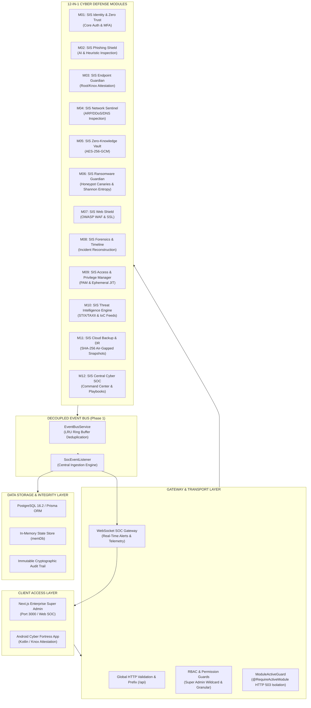
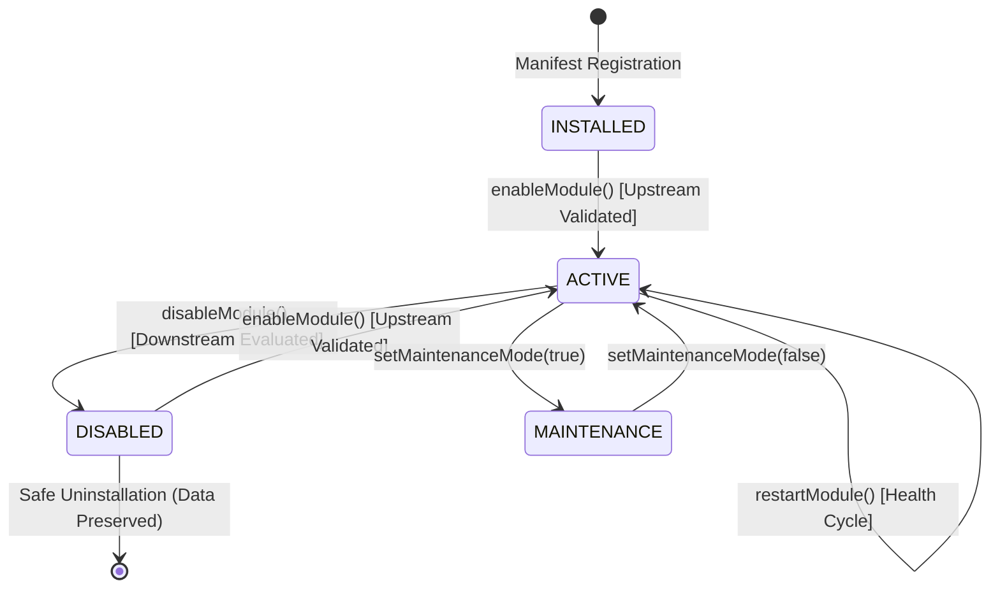

# SIS CYBER FORTRESS — 12-IN-1 MODULAR ECOSYSTEM ARCHITECTURE
**Document Version:** 2.0.0  
**Classification:** Enterprise Cyber Defense Specification  
**Architecture Paradigm:** Decoupled Event-Driven Micro-Modular Monolith  

---

## 1. ARCHITECTURAL OVERVIEW

**SIS CYBER FORTRESS** is an enterprise-grade, defense-in-depth cybersecurity ecosystem integrating 12 specialized defense domains into a unified command and telemetry infrastructure. 

The architecture strictly enforces:
1. **Decoupled Event-Driven Bus (`@nestjs/event-emitter`):** Cross-module telemetry, automated SOC escalation, and threat alerts communicate through strongly-typed pub/sub contracts, suppressing event loops with an LRU deduplication ring buffer.
2. **Runtime Lifecycle Isolation:** Any non-core module can be independently disabled, cycled, or placed into maintenance mode without restarting the server or breaking unrelated modules.
3. **Fail-Safe Active Module Guards (`@RequireActiveModule`):** Endpoints belonging to disabled modules fail gracefully with structured HTTP 503 Service Unavailable responses, preserving historical audit records and raw data stores.
4. **Zero-Knowledge Privacy Invariant:** Cryptographic secrets and vault records are protected by client-side AES-256-GCM derivation; the backend stores zero unencrypted secret plaintext or recovery backdoors.
5. **Unified Multi-Platform Consumption:** A shared NestJS backend powers both the Next.js Super Admin Command Center (Desktop/Tablet) and the Kotlin/Android Application (`com.sis.cyberfortress`) with real-time WebSocket (`SocGateway`) and REST API bindings.

---

## 2. HIGH-LEVEL ECOSYSTEM TOPOLOGY



---

## 3. DYNAMIC MODULE LIFECYCLE & STATE MACHINE

Each of the 12 modules is managed through the Central Module Registry (`ModulesService`). The module lifecycle progresses across strictly validated states:



### Module State Definitions
| State | HTTP Endpoint Behavior | Event Bus Activity | Data Persistence |
|---|---|---|---|
| `ACTIVE` | Normal Execution (HTTP 200/201) | Emits & Receives all Events | Full Read/Write |
| `DISABLED` | Intercepted by `ModuleActiveGuard` (HTTP 503) | Suppressed for module; Core bus active | 100% Preserved (Zero Data Loss) |
| `MAINTENANCE` | Intercepted by `ModuleActiveGuard` (HTTP 503) | Administrative telemetry only | Safe Offline Mode |
| `INSTALLED` | Standby / Uninitialized | Dormant | Config schema registered |

---

## 4. FAILURE ISOLATION & ZERO DATA LOSS GUARANTEES

1. **Unrelated Module Protection:** When a module is disabled (e.g., `sis-phishing`), unrelated modules (e.g., `sis-ransomware`, `sis-vault`, `sis-cyber-soc`) continue serving requests with zero disruption.
2. **Immutable Data Preservation:** Disabling a module alters only its registry state flag in memory/database. Quarantined threats, forensic snapshots, audit logs, and vault records are **never purged** on lifecycle state changes.
3. **Structured Graceful Degradation:** Consumers requesting a disabled module receive a clean, structured JSON payload:
   ```json
   {
     "statusCode": 503,
     "error": "Service Unavailable",
     "message": "Module 'SIS Phishing Shield' is currently DISABLED by administrator security policy. Underlying data remains preserved.",
     "moduleId": "sis-phishing",
     "moduleStatus": "DISABLED",
     "timestamp": "2026-11-11T12:00:00.000Z"
   }
   ```
4. **Core Pillar Immutability:** Core foundational modules (`sis-identity`, `sis-cyber-soc`) reject unauthorized disable requests. Disabling a core module requires explicit `force: true` root Super Admin override.

---

## 5. REPOSITORY CODE STRUCTURE

```
backend/src/
├── app.module.ts              # Root composition module importing all 12 modules
├── events/                    # Phase 1: Decoupled Internal Event Bus
│   ├── security-events.ts     # Strongly-typed event contracts & payloads
│   ├── event-bus.service.ts   # Central bus with LRU deduplication ring buffer
│   ├── events.module.ts       # Global dynamic events provider
│   └── listeners/             # Asynchronous cross-module listeners
│       └── soc-event.listener.ts
├── common/                    # Phase 3: Runtime Active Module Guard
│   ├── decorators/
│   │   └── require-active-module.decorator.ts
│   └── guards/
│       └── module-active.guard.ts
├── phishing/                  # Phase 2: Independent Phishing Shield Module
│   ├── phishing.controller.ts
│   ├── phishing.service.ts
│   ├── phishing.module.ts
│   └── dto/phishing.dto.ts
├── ransomware/                # Phase 2: Independent Ransomware Guardian Module
│   ├── ransomware.controller.ts
│   ├── ransomware.service.ts
│   ├── ransomware.module.ts
│   └── dto/ransomware.dto.ts
├── modules-center/            # Module Registry, Dependency Graph, Lifecycle Engine
├── soc/                       # Cyber SOC Command Center & WebSocket Gateway
├── auth/                      # Zero Trust Authentication & MFA
├── endpoint/                  # Knox & Play Integrity Mobile MDM
├── network/                   # Network Sentinel & Traffic Inspection
├── vault/                     # Zero-Knowledge Cryptographic Vault
├── threat-intel/              # IoC Feeds & Threat Correlation
├── forensics/                 # Incident Timeline & Digital Evidence
├── backups/                   # Air-Gapped Cloud Backup & DR
├── audit/                     # Immutable Compliance Audit Logs
└── prisma/                    # PostgreSQL Schema & In-Memory Fallback Store
```
