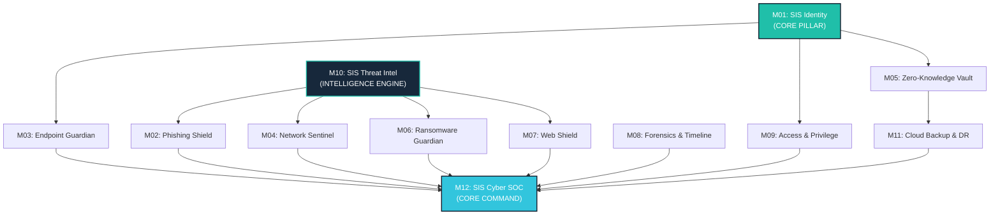

# SIS CYBER FORTRESS — MODULE DEPENDENCIES & IMPACT ANALYSIS
**Document Version:** 2.0.0  
**Scope:** Directed Acyclic Graph (DAG) & Lifecycle Dependency Protection  

---

## 1. DIRECTED DEPENDENCY GRAPH (DAG)

The SIS Cyber Fortress ecosystem uses a strict Directed Acyclic Graph (DAG) architecture to prevent circular deadlocks and ensure predictable initialization and teardown sequences.



---

## 2. MODULE DEPENDENCY MATRIX

| Module ID | Module Name | Core? | Upstream Dependencies (Required to be ACTIVE) | Downstream Dependents (Rely on this module) |
|---|---|---|---|---|
| `sis-identity` | SIS Identity & Zero Trust | **YES** | *None (Foundational)* | `sis-access`, `sis-vault`, `sis-endpoint` |
| `sis-threat-intel` | Threat Intelligence Engine | NO | `sis-identity` | `sis-phishing`, `sis-webshield`, `sis-ransomware`, `sis-network` |
| `sis-cyber-soc` | Central Cyber SOC | **YES** | `sis-identity` | *All modules send events to SOC* |
| `sis-phishing` | Phishing Shield | NO | `sis-threat-intel` | *None (Leaf Consumer)* |
| `sis-endpoint` | Endpoint Guardian | NO | `sis-identity` | `sis-cyber-soc` |
| `sis-network` | Network Sentinel | NO | `sis-threat-intel` | `sis-forensics` |
| `sis-vault` | Zero-Knowledge Vault | NO | `sis-identity` | `sis-cloud-backup` |
| `sis-ransomware`| Ransomware Guardian | NO | `sis-threat-intel` | `sis-cyber-soc` |
| `sis-webshield` | Web Shield | NO | `sis-threat-intel` | `sis-forensics` |
| `sis-forensics` | Forensics & Timeline | NO | `sis-cyber-soc` | *None (Leaf Consumer)* |
| `sis-access` | Access & Privilege Manager| NO | `sis-identity` | `sis-cyber-soc` |
| `sis-cloud-backup`| Cloud Backup & DR | NO | `sis-vault` | *None (Leaf Consumer)* |

---

## 3. LIFECYCLE PRE-VALIDATION & IMPACT LOGIC

Before any administrator can disable or alter the lifecycle state of a module, the Central Module Registry executes `checkDisableImpact(moduleId)`:

```typescript
checkDisableImpact(id: string) {
  const mod = this.getModuleById(id);

  // 1. Identify all active downstream dependents
  const activeDependents = this.prisma.memDb.modules.filter(
    (m) => m.status === 'ACTIVE' && m.dependencies && m.dependencies.includes(mod.id),
  );

  return {
    moduleId: mod.id,
    moduleName: mod.displayName,
    isCore: mod.isCore,
    canDisableDirectly: activeDependents.length === 0 && !mod.isCore,
    activeDependents: activeDependents.map((d) => ({
      id: d.id,
      name: d.displayName,
      version: d.version,
    })),
    consequences:
      activeDependents.length > 0
        ? `Disabling ${mod.displayName} will degrade or disrupt functionality for ${activeDependents.length} active dependent service(s): ${activeDependents.map((d) => d.displayName).join(', ')}.`
        : mod.isCore
        ? `CRITICAL: ${mod.displayName} is designated as an invariant CORE pillar of SIS Cyber Fortress. Disabling requires root Super Admin override.`
        : `Safe to disable. No active downstream dependencies are bound to this module. Historical data remains protected.`,
  };
}
```

### Safety Rules Enforced:
1. **Core Pillar Lock:** Modules with `isCore: true` (`sis-identity`, `sis-cyber-soc`) reject ordinary disable requests with HTTP 403 Forbidden. Only a verified Super Admin with `force: true` can override.
2. **Dependent Service Interlock:** If module $A$ has active downstream dependents $B_1, B_2$, disabling $A$ without `force: true` returns HTTP 400 Bad Request with the impact analysis object detailing affected systems.
3. **Upstream Activation Interlock:** A disabled module cannot be transitioned to `ACTIVE` if any of its listed upstream dependencies are currently `DISABLED`.
